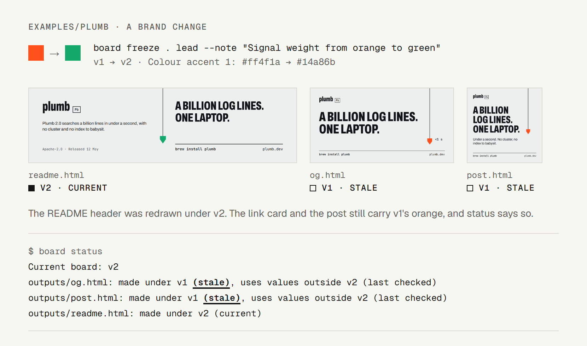

<p align="center">
  <picture>
    <source media="(prefers-color-scheme: dark)" srcset=".github/assets/banner-dark.png">
    
  </picture>
</p>

<p align="center"><strong>Briefatto Board gives coding agents one versioned design guide to read before visual work.</strong></p>

<p align="center">
  <a href="https://www.npmjs.com/package/briefatto-board"></a>
  <a href="https://github.com/Briefatto/briefatto-board/actions/workflows/ci.yml"></a>
  <a href="LICENSE"></a>
  <a href="#works-with-any-coding-agent"></a>
</p>

<p align="center">
  <picture>
    <source media="(prefers-color-scheme: dark)" srcset=".github/assets/idea-dark.png">
    
  </picture>
</p>

Your brand lives in one design guide, `DESIGN.md`, and Briefatto Board keeps it versioned. Every agent session reads the guide before drawing anything, every rendered piece is checked against a quality floor, and after a brand change you are told which pieces are out of date.

## Start

```sh
npx briefatto-board install
```

This adds Briefatto Board to your project and installs the skill your agent reads. Below, `board` stands for `npx briefatto-board`.

**You already have a site → adopt.** Briefatto Board captures your pages, your agent writes the design guide (`DESIGN.md`) from what it sees, and you freeze it as v1.

```sh
npx briefatto-board adopt .
npx briefatto-board freeze .
```

**Starting a brand → references → directions → pick → freeze.** Put the brief in `brief.md` and ask your agent to follow the skill. It shows you a sheet of references to point at, draws three directions from your picks, revises the one you choose and writes `DESIGN.md` and freezes it after your yes. Use the chosen direction ID in place of `lead`.

```sh
npx briefatto-board refs .
npx briefatto-board directions .
npx briefatto-board freeze . lead
```

Node.js 24 or later. The first render prints the Playwright command to install Chromium if it is missing.

## How it works

<p align="center">
  <picture>
    <source media="(prefers-color-scheme: dark)" srcset=".github/assets/flow-dark.png">
    
  </picture>
</p>

- **Versioned brand state.** `board freeze` validates `DESIGN.md` against a fresh render: every colour, font and size it names must appear in the chosen samples. It stamps a version and archives the guide, and adds a standing instruction to `AGENTS.md` and `CLAUDE.md` so every session reads `DESIGN.md` first.
- **A quality floor for every piece.** `board check` renders each piece and fails it for text that is clipped, off the canvas, over other text, too small where it is seen, in a font that never loaded, or below WCAG contrast, and for the anti-patterns found by the [Impeccable](https://github.com/pbakaus/impeccable) detector.
- **Truthful status.** Each piece declares the version it was made under. After a brand change, `board status` lists which pieces are current and which are stale.

This is what the CLI printed on the Plumb example, after a brand change: a stale link card, a redraw that fails the floor, the fix, and the status that follows.

<p align="center">
  <picture>
    <source media="(prefers-color-scheme: dark)" srcset=".github/assets/capture-dark.png">
    
  </picture>
</p>

### Works with any coding agent

Briefatto Board is a command-line tool and a skill file. It works with any coding agent that reads `AGENTS.md` and runs shell commands.

## Made with Briefatto Board

<p align="center">
  <picture>
    <source media="(prefers-color-scheme: dark)" srcset=".github/assets/gallery-dark.png">
    
  </picture>
</p>

Plumb is an invented open-source log search tool from [`examples/plumb`](examples/plumb/brief.md). Briefatto Board took it from its brief to a frozen design guide, and every piece passed `board check`.

### Examples

Try it on the other examples in [`examples/`](examples): [`bakery`](examples/bakery/brief.md), a brief with CC0 photographs, and [`current-site`](examples/current-site/README.md), a small site to adopt.

## Change the brand

<p align="center">
  <picture>
    <source media="(prefers-color-scheme: dark)" srcset=".github/assets/change-dark.png">
    
  </picture>
</p>

Record the client's words, update `DESIGN.md`, and freeze again with a note. `board diff` shows what changed, and `board status` shows what still needs revisiting. Nothing is redrawn behind your back.

```sh
npx briefatto-board freeze . lead --note "Signal weight from orange to green"
npx briefatto-board status
```

## Commands

| Command | What it does |
| :--- | :--- |
| `board install` | Adds Briefatto Board and its skill to a project |
| `board adopt .` | Captures an existing site's pages and computed styles |
| `board refs .` | Builds a reference sheet from entries in `refs/manifest.json` |
| `board directions .` | Renders each direction's samples as a sheet |
| `board freeze . [direction]` | Validates `DESIGN.md` and stamps the next version |
| `board check . <piece.html>` | Renders a piece and checks it against the quality floor |
| `board status` | Lists pieces as current, stale or unrecorded |
| `board log` · `board diff v1 v2` | Shows version history and what changed |

## Licence

Apache-2.0. See [LICENSE](LICENSE), [NOTICE](NOTICE) and [THIRD_PARTY.md](THIRD_PARTY.md).

---

<p align="center"><sub>Made by <a href="https://briefatto.com">Briefatto Lab</a>, design infrastructure for AI agents.</sub></p>
