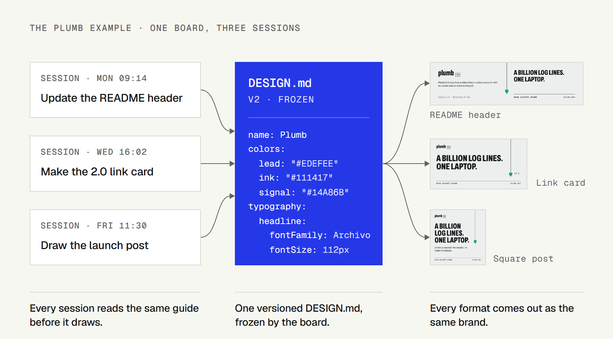

<p align="center">
  <picture>
    <source media="(prefers-color-scheme: dark)" srcset=".github/assets/banner-dark.png">
    
  </picture>
</p>

<p align="center"><strong><a href="https://github.com/Briefatto/briefatto-board">Briefatto Board</a> gives coding agents one versioned design guide to read before visual work.</strong></p>

<p align="center">
  <a href="https://www.npmjs.com/package/briefatto-board"></a>
  <a href="LICENSE"></a>
  <a href="#works-with-any-coding-agent"></a>
</p>

<p align="center">
  <picture>
    <source media="(prefers-color-scheme: dark)" srcset=".github/assets/idea-dark.png">
    
  </picture>
</p>

Your brand lives in one file, `DESIGN.md`, and the board keeps it versioned. Every agent session reads it before drawing anything, every rendered piece is checked against a floor of basic craft, and after a brand change the board tells you which pieces are out of date.

## Start in 30 seconds

```sh
npx briefatto-board install
```

This adds the board to your project and installs the skill your agent reads. Below, `board` stands for `npx briefatto-board`.

**You already have a site → adopt.** The board captures your pages, your agent writes `DESIGN.md` from what it sees, and you freeze it as v1.

```sh
npx briefatto-board adopt .
# Write DESIGN.md from the captured pages before freezing.
npx briefatto-board freeze .
```

**Starting a brand → references → directions → pick → freeze.** Put the brief in `brief.md` and ask your agent to follow the skill. It prepares the reference manifest, shows you a sheet of references to point at, draws three directions from your picks, revises the one you choose and freezes it after your yes.

```sh
npx briefatto-board refs .
npx briefatto-board directions .
# Write DESIGN.md for the chosen direction and use its ID (lead in Plumb).
npx briefatto-board freeze . lead
```

Node.js 24 or later. The first render prints the Playwright command to install Chromium if it is missing.

## How it works

<p align="center">
  <picture>
    <source media="(prefers-color-scheme: dark)" srcset=".github/assets/flow-dark.png">
    
  </picture>
</p>

- **Versioned brand state.** `board freeze` validates the declared colours, font families and type sizes in `DESIGN.md` against fresh renders of the selected pages or samples. It stamps a version and archives the guide, and adds a standing instruction to `AGENTS.md` and `CLAUDE.md` so every session reads `DESIGN.md` first.
- **The no-AI-smell floor.** `board check` renders each piece and fails it for text that is clipped, off the canvas, over other text, too small where it is seen, in a font that never loaded, or below WCAG contrast. It also uses the [Impeccable](https://github.com/pbakaus/impeccable) detector to catch common anti-patterns.
- **Truthful status.** Each piece declares the version it was made under. After a brand change, `board status` lists which pieces are current and which are stale.

### Works with any coding agent

The board is a command-line tool and a skill file. It works with any coding agent that reads `AGENTS.md` and runs shell commands.

## Made with the board

<p align="center">
  <picture>
    <source media="(prefers-color-scheme: dark)" srcset=".github/assets/gallery-dark.png">
    
  </picture>
</p>

Plumb is an invented open-source log search tool from [`examples/plumb`](examples/plumb/brief.md). The board took it from its brief to a frozen guide, and every piece passed `board check`.

### Examples

Try the board on the other examples in [`examples/`](examples): [`bakery`](examples/bakery/brief.md), a brief with CC0 photographs, and [`current-site`](examples/current-site/README.md), a small site to adopt.

## Change the brand

<p align="center">
  <picture>
    <source media="(prefers-color-scheme: dark)" srcset=".github/assets/change-dark.png">
    
  </picture>
</p>

Record the client's words, update `DESIGN.md`, and freeze again with a note. `board diff` shows what changed, and `board status` shows what still needs revisiting. Nothing is redrawn behind your back. Here is the Plumb example.

```sh
npx briefatto-board freeze . lead --note "Signal weight from orange to green"
npx briefatto-board status
```

## Commands

| Command | What it does |
| :--- | :--- |
| `board install` | Adds the board and its skill to a project |
| `board adopt .` | Captures an existing site's pages and computed styles |
| `board refs .` | Builds a sheet from the captured references |
| `board directions .` | Renders each direction's samples as a sheet |
| `board freeze . [direction]` | Validates `DESIGN.md` and stamps the next version |
| `board check . <piece.html>` | Renders a piece and runs the no-AI-smell floor |
| `board status` | Lists pieces as current, stale or unrecorded |
| `board log` · `board diff v1 v2` | Shows version history and what changed |

## Licence

Apache-2.0. See [LICENSE](LICENSE), [NOTICE](NOTICE) and [THIRD_PARTY.md](THIRD_PARTY.md).

---

<p align="center"><sub>Made by <a href="https://briefatto.com">Briefatto Lab</a>, design infrastructure for AI agents.</sub></p>
