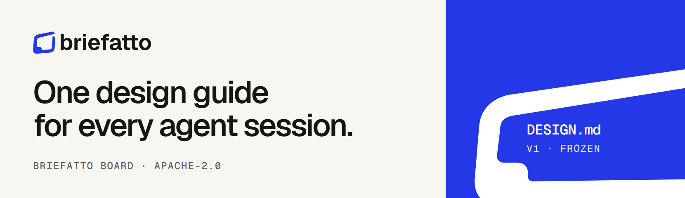
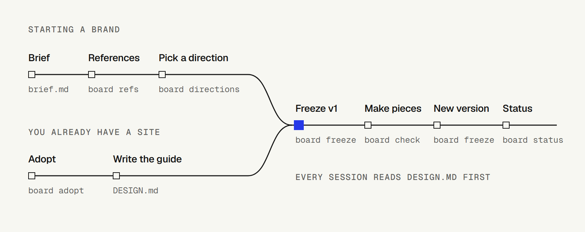
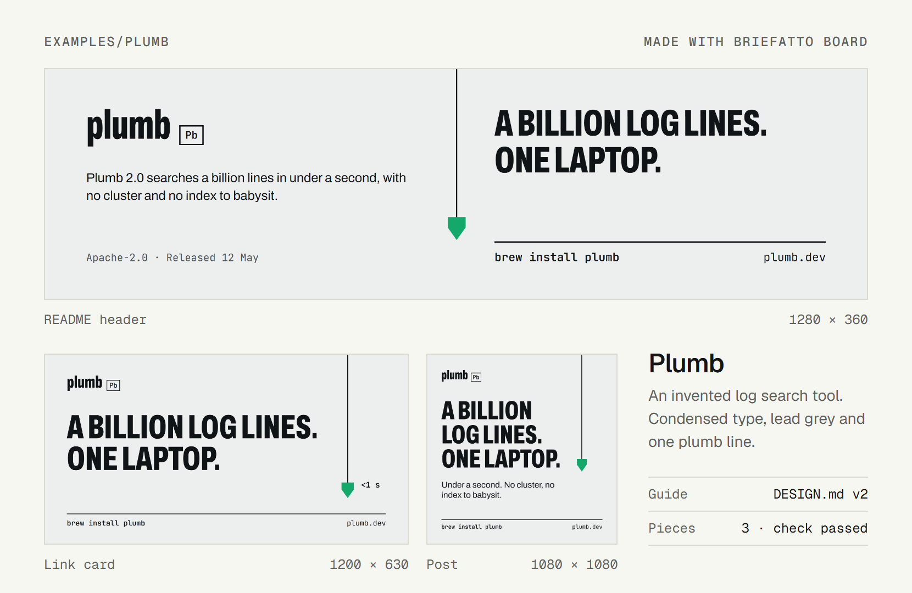

# Briefatto Board
One versioned design guide (DESIGN.md) that Claude Code, Codex, Cursor, GitHub Copilot, Gemini CLI, Windsurf and every other coding agent reads before visual work. `npx briefatto-board install` adds a pointer to AGENTS.md and CLAUDE.md, and each rendered piece is checked against a quality floor.

```sh
npx briefatto-board install
```

You can also install the skill through skills.sh.

```sh
npx skills add Briefatto/briefatto-board
```

Or as a Claude Code plugin.

```sh
claude plugin marketplace add Briefatto/briefatto-board
claude plugin install briefatto-board@briefatto
```

**Blind-tested.** On a real open-source site, all four blind judges ranked Briefatto Board's work first, ahead of Impeccable, Taste Skill and Hallmark. [See every kit side by side](https://briefatto.com/guides/impeccable-vs-taste-skill-vs-hallmark-blind-test/). On a second site, Pyxel, all four blind judges again ranked it first, this time ahead of Anthropic's frontend-design skill: [blind test 2](https://briefatto.com/guides/frontend-design-skill-vs-briefatto-board-blind-test/). On a third site, PocketBase, every blind judge ranked it above UI UX Pro Max: [blind test 3](https://briefatto.com/guides/ui-ux-pro-max-vs-briefatto-board-blind-test/).

**Measured, not claimed.** In an empty repo where the brand could travel only by file, Claude Code and Codex matched the brand's fonts in 0 of 18 pieces without a DESIGN.md and in 53 of 54 with one. [See the drift test](https://briefatto.com/guides/does-design-md-keep-your-brand-drift-test/).

[Adopt an existing site or start a brand from a brief](#start). [Guides for Claude Code, Codex, Cursor, Copilot, Gemini CLI and more](https://briefatto.com/guides/). [39 ready DESIGN.md files for popular brands](https://github.com/Briefatto/design-md-gallery).

<p align="center">
  <picture>
    <source media="(prefers-color-scheme: dark)" srcset=".github/assets/banner-dark.png">
    
  </picture>
</p>

<p align="center">
  <a href="https://www.npmjs.com/package/briefatto-board"></a>
  <a href="https://github.com/Briefatto/briefatto-board/actions/workflows/ci.yml"></a>
  <a href="LICENSE"></a>
  <a href="#works-with-any-coding-agent"></a>
</p>

<p align="center">
  <picture>
    <source media="(prefers-color-scheme: dark)" srcset=".github/assets/idea-dark.png">
    
  </picture>
</p>

Your brand lives in one design guide, `DESIGN.md`, and Briefatto Board keeps it versioned. Every agent session reads the guide before drawing anything, every rendered piece is checked against a quality floor, and after a brand change you are told which pieces are out of date.

## Start

Below, `board` stands for `npx briefatto-board`.

**You already have a site → adopt.** Briefatto Board captures your pages, your agent writes the design guide (`DESIGN.md`) from what it sees, and you freeze it as v1.

```sh
npx briefatto-board adopt .
npx briefatto-board freeze .
```

**Starting a brand → references → directions → pick → freeze.** Put the brief in `brief.md` and ask your agent to follow the skill. It shows you a reference sheet, draws three directions from your picks, revises the one you choose and writes the design guidance after your yes. Use the chosen direction ID in place of `lead`.

```sh
npx briefatto-board refs .
npx briefatto-board directions .
npx briefatto-board freeze . lead
```

Before v1, put the client's exact production approval in a fenced `approval lead` block in `refs/notes.md`. Replace `lead` with the chosen direction ID. If you are working alone as your own client, run `board freeze . lead --self-approved`. `board log` records the decision.

Node.js 24 or later. The first render prints the Playwright command to install Chromium if it is missing.

## How it works

<p align="center">
  <picture>
    <source media="(prefers-color-scheme: dark)" srcset=".github/assets/flow-dark.png">
    
  </picture>
</p>

- **Versioned brand state.** `board freeze` records source wording and exact styles from a fresh render in a generated DESIGN.md block. It validates the authored guidance against those values, stamps and archives the guide, and tells future sessions to read it first.
- **A quality floor for every piece.** `board check` renders each piece and fails it for text that is clipped, off the canvas, over other text, too small where it is seen, in a font that never loaded, or below WCAG contrast, and for the anti-patterns found by the [Impeccable](https://github.com/pbakaus/impeccable) detector.
- **Truthful status.** Each piece declares the version it was made under. After a brand change, `board status` lists which pieces are current and which are stale.

This is what the CLI printed on the Plumb example, after a brand change: a stale link card, a redraw that fails the floor, the fix, and the status that follows.

<p align="center">
  <picture>
    <source media="(prefers-color-scheme: dark)" srcset=".github/assets/capture-dark.png">
    
  </picture>
</p>

## Design principles

A design system's first reader is now a coding agent. We built Briefatto Board for that reader, on one split: taste in the model, proof in code.

- **Taste belongs to the model.** Your agent's model makes every aesthetic call and improves every year. We ship no taste rubric: one would cap the model and become its target.
- **The floor belongs to code.** `board check` fails what is provably wrong: text that is clipped, off the canvas, overlapping or too small where it is seen, fonts that never loaded, contrast below WCAG, Impeccable's anti-patterns. Exported PNG and PDF files match their source.
- **One brand for every agent.** Claude Code, Codex, Cursor, Copilot and Gemini CLI read the same frozen DESIGN.md, months and sessions apart, and after a brand change `board status` names every stale piece.
- **Pictures carry intent.** Designers never closed the intent gap with words. Agents get references, directions drawn as pictures and a client's pick.
- **The repository is the brand system.** DESIGN.md lives in Git, so review, pull requests, permissions and history work on it. `board freeze`, `board diff` and `board status` add brand versions.

Read the full [design principles](docs/PRINCIPLES.md) and [how it works](docs/ARCHITECTURE.md).

### Works with any coding agent

Briefatto Board is a command-line tool and a skill file. It works with any coding agent that reads `AGENTS.md` and runs shell commands. That includes Claude Code (through `CLAUDE.md`) and the agents that read `AGENTS.md`: Codex, Cursor, GitHub Copilot, Gemini CLI, Windsurf, Zed, OpenCode, Amp, Jules, Devin, Aider, goose, Warp, Junie, Roo Code, Kilo Code, Factory and Augment Code.

## Made with Briefatto Board

<p align="center">
  <picture>
    <source media="(prefers-color-scheme: dark)" srcset=".github/assets/gallery-dark.png">
    
  </picture>
</p>

Plumb is an invented open-source log search tool from [`examples/plumb`](examples/plumb/brief.md). Briefatto Board took it from its brief to a frozen design guide, and every piece passed `board check`.

### Examples

Try it on the other examples in [`examples/`](examples): [`bakery`](examples/bakery/brief.md), a brief with CC0 photographs, and [`current-site`](examples/current-site/README.md), a small site to adopt.

## Check the files you ship

Export the finished files and list every delivery PNG and PDF in project-root `deliverables.json`. Each entry names the actual file, its editable HTML source, and the exact comparison size in pixels. Use project-relative paths.

```json
[
  {"file":"delivery/card.png","html":"outputs/post.html","width":1080,"height":1080},
  {"file":"delivery/poster.pdf","html":"outputs/poster.html","width":1212,"height":1704,"pageSizeMm":{"width":303,"height":426}}
]
```

- Add `"transparent":true` for a transparent PNG. Use `viewport` with `width` and `height` when the HTML lays out at a different CSS size. Board scales the capture by the export width divided by the viewport width. Add `"fullPage":true` for a PNG of the full scroll height.
- PDF entries describe one page. Board rasterizes the page with PDF.js and compares it with the HTML in print media. The page aspect must fit within one comparison pixel on either axis. Optional `pageSizeMm` checks the visible page box to within 0.1 mm on each axis. Use the full page size including bleed when the visible page includes it.
- A PNG must match every decoded RGBA pixel. Board ignores RGB values under fully transparent pixels. Lossless encoding of the same Chromium capture preserves these pixels exactly. PDFs allow a mean maximum-channel difference of 2 on a 0–255 scale and at most 2% of pixels differing by more than 32. In each 64 × 64 pixel tile, Board also compares pixels in both directions within one pixel of their position to account for rasterizer edge placement. The mean after this allowance must be at most 5. The A3 export measured 0.40 overall, 0.53% above 32, and 2.44 in the worst tile. A smaller type-and-vector PDF also passes. Removing a short date line stayed within the overall limits and exceeded the tile limit. The PDF regressions cover both scenarios.

Run `board check .` to validate the listed files, or pass HTML filenames to run layout checks too. `board kit .` requires a frozen guide and includes the layout checks and final-file results in `outputs/kit-check.json`. Each export row records the SHA-256 of the checked bytes. Use independently renderable HTML as the source for each export. With no manifest, `board check` renders HTML previews. `board kit` checks the format-named PNGs alongside their HTML and creates one only if it is missing. Use `board render <file.html>` to regenerate these PNGs after editing the HTML.

## Change the brand

<p align="center">
  <picture>
    <source media="(prefers-color-scheme: dark)" srcset=".github/assets/change-dark.png">
    
  </picture>
</p>

Record the client's words, update `DESIGN.md`, and freeze again with a note. `board diff` shows what changed, and `board status` shows what still needs revisiting. Nothing is redrawn behind your back.

```sh
npx briefatto-board freeze . lead --note "Signal weight from orange to green"
npx briefatto-board status
```

## Commands

| Command | What it does |
| :--- | :--- |
| `board install` | Adds Briefatto Board and its skill to a project |
| `board adopt .` | Captures an existing site's pages and computed styles |
| `board refs .` | Builds a reference sheet from entries in `refs/manifest.json` |
| `board directions .` | Renders each direction's samples as a sheet |
| `board freeze . [direction]` | Generates source and sample values, validates the prose, and stamps the next guide version |
| `board check . [<piece.html>]` | Checks the visual floor on supplied HTML and verifies final PNG and PDF files |
| `board kit .` | Requires a frozen guide and checks the campaign and final exports for the kit receipt |
| `board status` | Lists pieces as current, stale or unrecorded |
| `board log` · `board diff v1 v2` | Shows version history and what changed |

## Licence

Apache-2.0. See [LICENSE](LICENSE), [NOTICE](NOTICE) and [THIRD_PARTY.md](THIRD_PARTY.md).

---

<p align="center"><sub>Made by <a href="https://briefatto.com">Briefatto Lab</a>, design infrastructure for AI agents.</sub></p>
