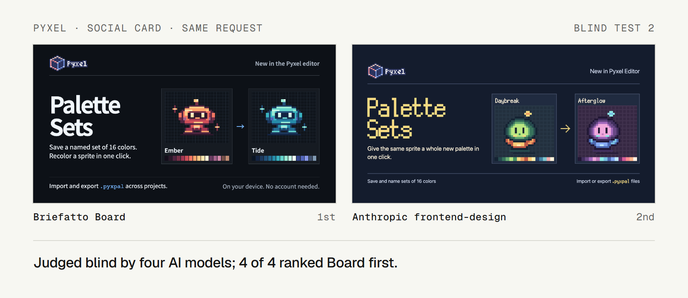
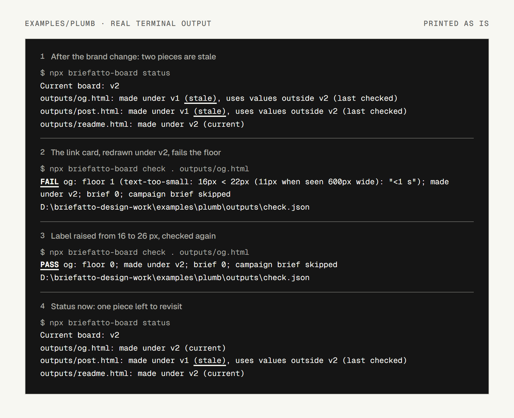

<p align="center">
  <picture>
    <source media="(prefers-color-scheme: dark)" srcset=".github/assets/banner-dark.png">
    
  </picture>
</p>

<p align="center">
  <a href="https://www.npmjs.com/package/briefatto-board"></a>
  <a href="https://github.com/Briefatto/briefatto-board/actions/workflows/ci.yml"></a>
  <a href="LICENSE"></a>
</p>

Briefatto Board is the design layer for every agent. Your brand lives in one versioned `DESIGN.md` that every agent reads before it draws, and every rendered piece must pass a quality floor checked in code.

```sh
npx briefatto-board install
```

<p align="center">
  <a href="https://briefatto.com/guides/frontend-design-skill-vs-briefatto-board-blind-test/">
    <picture>
      <source media="(prefers-color-scheme: dark)" srcset=".github/assets/proof-dark.png">
      
    </picture>
  </a>
</p>

**Blind-tested.** On three open-source sites, Briefatto Board came first with 4 of 4, 4 of 4 and 3 of 4 blind AI-model judges, against Impeccable, Taste Skill, Hallmark, Anthropic's frontend-design skill and UI UX Pro Max. [Raw data](https://huggingface.co/datasets/briefatto-lab/design-kit-evals) · [DOI](https://doi.org/10.5281/zenodo.24436111) · [test 1](https://briefatto.com/guides/impeccable-vs-taste-skill-vs-hallmark-blind-test/) · [test 2](https://briefatto.com/guides/frontend-design-skill-vs-briefatto-board-blind-test/) · [test 3](https://briefatto.com/guides/ui-ux-pro-max-vs-briefatto-board-blind-test/)

<p align="center">
  <picture>
    <source media="(prefers-color-scheme: dark)" srcset=".github/assets/idea-dark.png">
    
  </picture>
</p>

**Measured.** In an empty repo where the brand could travel only by file, Claude Code and Codex matched the brand's fonts in 0 of 18 pieces without a DESIGN.md and in 53 of 54 with one. [See the drift test](https://briefatto.com/guides/does-design-md-keep-your-brand-drift-test/).

[Adopt an existing site or start a brand from a brief](#start). [Guides for every agent](https://briefatto.com/guides/). [110 ready DESIGN.md files for popular brands](https://github.com/Briefatto/design-md-gallery).

## Start

`install` adds the skill and writes a pointer to the guide into `AGENTS.md` and `CLAUDE.md`.

**You already have a site → adopt.** Briefatto Board captures your pages, your agent writes the design guide (`DESIGN.md`) from what it sees, and you freeze it as v1.

```sh
npx briefatto-board adopt .
npx briefatto-board freeze .
```

**Starting a brand → directions → pick → kit.** Put the brief in `brief.md` and ask your agent to follow the skill. It draws three directions with your real copy and stops once: pick one, ask for changes, or say 'you choose'. Any fact the brief leaves out is asked for in that same message and never invented. Then it writes the design guide, freezes it and makes the kit. The freeze names the direction you picked; here it is `lead`.

```sh
npx briefatto-board directions .
npx briefatto-board freeze . lead
```

Your pick is the approval, and `board log` records it.

Node.js 24 or later. The first render prints the Playwright command to install Chromium if it is missing.

### Other ways to install

On skills.sh:

```sh
npx skills add Briefatto/briefatto-board
```

As a Claude Code plugin:

```sh
claude plugin marketplace add Briefatto/briefatto-board
claude plugin install briefatto-board@briefatto
```

## How it works

<p align="center">
  <picture>
    <source media="(prefers-color-scheme: dark)" srcset=".github/assets/flow-dark.png">
    
  </picture>
</p>

- **Versioned brand state.** `board freeze` records source wording and exact styles from a fresh render in a generated DESIGN.md block. It validates the authored guidance against those values, stamps and archives the guide, and tells future sessions to read it first.
- **A quality floor for every piece.** `board check` renders each piece and fails it for text that is clipped, off the canvas, over other text, too small where it is seen, in a font that never loaded, or below WCAG contrast, and for the anti-patterns found by the [Impeccable](https://github.com/pbakaus/impeccable) detector.
- **Truthful status.** Each piece declares the version it was made under. After a brand change, `board status` lists which pieces are current and which are stale.

This is what the CLI printed on the Plumb example after a brand change: what changed, which pieces went stale, and the status once the link card was redrawn.

<p align="center">
  <picture>
    <source media="(prefers-color-scheme: dark)" srcset=".github/assets/capture-dark.png">
    
  </picture>
</p>

## Design principles

A design system's first reader is now an agent. We built Briefatto Board for that reader, on one split: taste in the model, proof in code.

- **Taste belongs to the model.** Your agent's model makes every aesthetic call and improves every year. We ship no taste rubric: one would cap the model and become its target.
- **The floor belongs to code.** `board check` fails what is provably wrong: text that is clipped, off the canvas, overlapping or too small where it is seen, fonts that never loaded, contrast below WCAG, Impeccable's anti-patterns. Exported PNG and PDF files match their source.
- **One brand for every agent.** Every agent reads the same frozen DESIGN.md, months and sessions apart, and after a brand change `board status` names every stale piece.
- **Pictures carry intent.** Designers never closed the intent gap with words. The agent draws three directions with your real copy. You point at one, or say 'you choose'.
- **The repository is the brand system.** DESIGN.md lives in Git, so review, pull requests, permissions and history work on it. `board freeze`, `board diff` and `board status` add brand versions.

Read the full [design principles](docs/PRINCIPLES.md) and [how it works](docs/ARCHITECTURE.md).

### Every agent

Briefatto Board works with every agent. The guide is a plain file in your project, the protocol is a plain skill file, and the work is done by a CLI any agent can call.

## Made with Briefatto Board

<p align="center">
  <picture>
    <source media="(prefers-color-scheme: dark)" srcset=".github/assets/gallery-dark.png">
    
  </picture>
</p>

Plumb is an invented open-source log search tool from [`examples/plumb`](examples/plumb/brief.md). Briefatto Board took it from its brief to a frozen design guide, and every piece passed `board check`.

### Examples

Try it on the other examples in [`examples/`](examples): [`bakery`](examples/bakery/brief.md), a brief with CC0 photographs, and [`current-site`](examples/current-site/README.md), a small site to adopt.

## Check the files you ship

List every delivery PNG and PDF in `deliverables.json`, and `board check .` verifies each file against its HTML source: PNGs pixel for pixel, PDFs within a rasterizer tolerance. [Export checks](docs/ARCHITECTURE.md#export-checks).

## Change the brand

<p align="center">
  <picture>
    <source media="(prefers-color-scheme: dark)" srcset=".github/assets/change-dark.png">
    
  </picture>
</p>

Record the client's words, update `DESIGN.md`, and freeze again with a note. `board diff` shows what changed, and `board status` shows what still needs revisiting. You decide what gets redrawn.

```sh
npx briefatto-board freeze . lead --note "Signal weight from orange to green"
npx briefatto-board status
```

## Commands

| `npx briefatto-board …` | What it does |
| :--- | :--- |
| `install` | Adds Briefatto Board and its skill to a project |
| `adopt .` | Captures an existing site's pages and computed styles |
| `refs .` | Captures references and builds a sheet from entries in `refs/manifest.json` |
| `directions .` | Renders the directions' samples into one comparison sheet, `directions/sheet.png` |
| `freeze . [direction]` | Generates source and sample values, validates the prose, and stamps the next guide version |
| `check . [<piece.html>]` | Checks the visual floor on supplied HTML and verifies final PNG and PDF files |
| `kit .` | Requires a frozen guide and checks the campaign and final exports for the kit receipt |
| `status` | Lists pieces as current, stale or unrecorded |
| `log` · `diff v1 v2` | Shows version history and what changed |

## Licence

Apache-2.0. See [LICENSE](LICENSE), [NOTICE](NOTICE) and [THIRD_PARTY.md](THIRD_PARTY.md).

---

<p align="center"><a href="https://briefatto.com">Briefatto Lab</a> builds design infrastructure for AI agents. One day, every pixel an agent ships will pass through Briefatto.</p>
